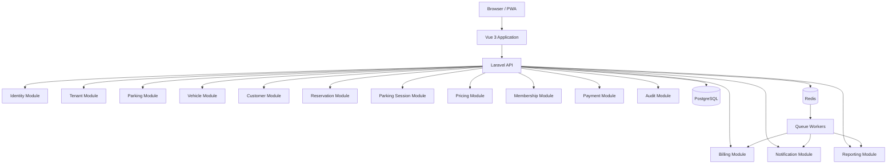

# NUVORA

## Networked Urban Vehicle Operations & Resource Administration

**Technical Product Specification & Engineering Guide**

> Nuvora is a multi-tenant, web-first SaaS platform designed to provide comprehensive management, operation, monitoring, billing, reservation and analytics capabilities for parking facilities.

---

# 1. Document Purpose

This document defines the technical foundation, architecture, engineering standards, functional scope, non-functional requirements, development methodology and long-term roadmap for Nuvora.

This is an **internal engineering document**.

It is not intended to function as a marketing README or public project description.

The document should be treated as the technical baseline for the development team.

---


# 2. Product Vision

Nuvora aims to provide a complete digital operating platform for parking businesses.

The platform must be capable of supporting:

- Independent parking facilities.
- Multi-location parking operators.
- Parking chains.
- Shopping centers.
- Hospitals.
- Universities.
- Airports.
- Hotels.
- Commercial buildings.
- Residential complexes.
- Corporate parking facilities.
- Public/private parking operators.
- Fleet-oriented parking operations.

Nuvora must not be designed around one specific parking business.

The system must provide a configurable domain model capable of adapting to different operational models, pricing strategies, access systems, payment methods and parking configurations.

---


# 3. Product Principles

The system must follow these principles:

1. **Multi-tenancy by design**
2. **Security by default**
3. **Configuration over hardcoding**
4. **Modular architecture**
5. **Domain-driven design**
6. **API-first backend**
7. **Web-first user experience**
8. **Hardware-provider independence**
9. **Observability from day one**
10. **Testability**
11. **Horizontal scalability**
12. **Backward-compatible APIs**
13. **Auditability**
14. **Idempotency for financial and operational operations**
15. **Explicit business rules**
16. **Infrastructure reproducibility**
17. **Progressive complexity**
18. **No premature microservices**

---


# 4. Core Product Concept

Nuvora operates around the following hierarchy:

```text
Platform
│
├── Tenants
│
│   ├── Users
│   ├── Roles
│   ├── Billing
│   │
│   ├── Parking Lot
│   │   ├── Zones
│   │   ├── Spaces
│   │   ├── Gates
│   │   ├── Devices
│   │   ├── Cameras
│   │   └── Pricing Rules
│   │
│   ├── Customers
│   ├── Vehicles
│   ├── Reservations
│   ├── Memberships
│   ├── Parking Sessions
│   ├── Payments
│   ├── Invoices
│   ├── Reports
│   └── Audit Logs
│
└── Platform Administration
```

---


# 5. Technology Stack


## 5.1 Frontend

```text
Vue 3
TypeScript
Vite
Pinia
Vue Router
VueUse
Axios
Tailwind CSS
Vitest
Playwright
```

The frontend must be written entirely in TypeScript.

JavaScript-only application code should not be introduced.

---


# 6. Backend

```text
PHP
Laravel
Laravel Sanctum
Laravel Reverb
Laravel Queue
Laravel Events
Laravel Notifications
Laravel Scheduler
Laravel Policies
Laravel Validation
Laravel HTTP Client
```

Laravel will be used as the primary application framework.

The backend will initially be implemented as a **Modular Monolith**.

---


# 7. Database

Primary database:

```text
PostgreSQL
```

PostgreSQL will be the system of record.

The database must be treated as a critical component of the domain.

The application must not rely on application-level checks alone for critical invariants.

Database constraints must be used where appropriate.

Examples:

```text
UNIQUE
FOREIGN KEY
CHECK
NOT NULL
INDEX
EXCLUSION CONSTRAINT
ROW LEVEL SECURITY
```

---


# 8. Cache and Queues

```text
Redis
```

Redis will be used for:

- Cache.
- Queue backend.
- Rate limiting.
- Temporary state.
- Distributed locks where required.
- Realtime support.
- Performance optimization.

Redis must not be considered the source of truth for persistent business data.

---


# 9. Realtime

Realtime functionality:

```text
Laravel Reverb
WebSockets
```

Potential realtime events:

```text
VehicleEntered
VehicleExited
ParkingSpaceOccupied
ParkingSpaceReleased
ReservationCreated
ReservationExpired
PaymentCompleted
PaymentFailed
DeviceStatusChanged
LprDetectionReceived
```

Realtime functionality must never be the only mechanism responsible for maintaining business state.

The database remains authoritative.

---


# 10. Infrastructure

Development:

```text
Docker
Docker Compose
```

Production:

```text
Linux
Docker
Nginx
PostgreSQL
Redis
Object Storage
TLS
```

Cloud provider must remain infrastructure-agnostic.

Possible deployment targets:

```text
AWS
Azure
Google Cloud
DigitalOcean
Hetzner
Other compatible infrastructure
```

---


# 11. CI/CD

```text
GitHub Actions
```

Pipeline:

```text
Push / Pull Request
        │
        ▼
Static Analysis
        │
        ▼
Lint
        │
        ▼
Unit Tests
        │
        ▼
Feature Tests
        │
        ▼
Frontend Tests
        │
        ▼
Build
        │
        ▼
Docker Build
        │
        ▼
Security Checks
        │
        ▼
Deployment
```

Production deployments must be automated and reproducible.

---


# 12. Architecture

Nuvora will use a **Modular Monolith architecture**.

The application will not initially be split into independent microservices.

The objective is to maintain strong domain boundaries while avoiding premature distributed-system complexity.




---


# 13. Architecture Layers

Each module should follow a consistent layered structure.

```text
Presentation
     │
     ▼
Application
     │
     ▼
Domain
     │
     ▼
Infrastructure
```


## Presentation

Responsible for:

- HTTP.
- Controllers.
- Requests.
- Resources.
- Authentication context.
- API serialization.


## Application

Responsible for:

- Use cases.
- Commands.
- Queries.
- Application services.
- DTOs.
- Transaction orchestration.


## Domain

Responsible for:

- Entities.
- Value Objects.
- Domain services.
- Domain events.
- Business rules.
- Invariants.


## Infrastructure

Responsible for:

- Eloquent implementations.
- Repositories.
- External APIs.
- Payment providers.
- LPR providers.
- Storage.
- Messaging.
- Technical integrations.

---


# 14. Proposed Project Structure

```text
app/
│
├── Modules/
│
│   ├── Identity/
│   │   ├── Domain/
│   │   ├── Application/
│   │   ├── Infrastructure/
│   │   └── Presentation/
│   │
│   ├── Tenancy/
│   ├── Parking/
│   ├── Vehicles/
│   ├── Customers/
│   ├── Reservations/
│   ├── ParkingSessions/
│   ├── Pricing/
│   ├── Memberships/
│   ├── Payments/
│   ├── Billing/
│   ├── Notifications/
│   ├── Reporting/
│   ├── Analytics/
│   ├── Devices/
│   ├── AccessControl/
│   ├── LPR/
│   ├── Audit/
│   └── Platform/
│
├── Shared/
│   ├── Domain/
│   ├── Application/
│   ├── Infrastructure/
│   └── Presentation/
│
└── Support/
```

---


# 15. Module Boundaries

Modules must communicate through:

- Application contracts.
- Domain events.
- Explicit interfaces.
- DTOs.
- Queries.
- Commands.

Direct access to another module's internal classes should be avoided.

Bad:

```php
ParkingService
    -> directly manipulates
PaymentRepository
```

Preferred:

```text
Parking
    │
    └── emits ParkingSessionCompleted
                    │
                    ▼
                Payments
```

---


# 16. Multi-Tenancy

Multi-tenancy is a core architectural requirement.

Nuvora must support multiple independent companies using the same platform.

Example:

```text
Tenant A
├── Parking Central
├── Parking Norte
└── Parking Mall

Tenant B
├── Parking Plaza
└── Parking Airport
```

Data isolation is mandatory.

---


# 17. Multi-Tenant Strategy

Initial strategy:

```text
Shared Database
Shared Schema
tenant_id
PostgreSQL Row-Level Security
Application Tenant Context
```

Most tenant-owned tables must include:

```text
tenant_id
```

Example:

```text
parking_lots
----------------
id
tenant_id
name
address
timezone
status
created_at
updated_at
```

---


# 18. Tenant Context

Every authenticated request must resolve a tenant context.

Conceptually:

```text
Request
   │
   ▼
Authentication
   │
   ▼
Tenant Resolution
   │
   ▼
Authorization
   │
   ▼
Application Logic
   │
   ▼
Database
```

Tenant resolution must never rely exclusively on a user-provided `tenant_id`.

The tenant must be derived from trusted authentication/session context and validated against the user's memberships.

---


# 19. Tenant Isolation

The following protections must exist:

### Layer 1

Application tenant scope.

### Layer 2

Authorization policies.

### Layer 3

Repository/query restrictions.

### Layer 4

Database constraints.

### Layer 5

PostgreSQL Row-Level Security for critical tenant-owned data.

This creates defense in depth.

---


# 20. Platform vs Tenant

There are two administrative scopes.

## Platform

Nuvora's own administration.

```text
Platform Admin
├── Tenants
├── Subscriptions
├── Platform Users
├── System Health
├── Platform Configuration
├── Feature Flags
├── Audit
└── Infrastructure
```


## Tenant

Customer organization.

```text
Tenant Admin
├── Parking Lots
├── Users
├── Customers
├── Vehicles
├── Pricing
├── Reservations
├── Memberships
├── Payments
├── Reports
└── Configuration
```

---


# 21. Tenant Hierarchy

```text
Tenant
│
├── Users
│
├── Parking Lots
│   │
│   ├── Zones
│   │   ├── Spaces
│   │   └── Pricing
│   │
│   ├── Gates
│   ├── Cameras
│   ├── Devices
│   └── Operating Hours
│
├── Customers
├── Vehicles
├── Memberships
├── Reservations
├── Sessions
└── Payments
```

---


# 22. User Roles

Initial role model:

```text
Platform Owner

Tenant Owner
Tenant Administrator
Supervisor
Cashier
Parking Operator
Accountant
Report Viewer
```

Roles should not be hardcoded into authorization logic.

Permissions must be granular.

Example:

```text
parking.view
parking.create
parking.update
parking.delete

vehicles.view
vehicles.create
vehicles.update

sessions.create
sessions.close

payments.view
payments.create
payments.refund

reports.view

users.manage
roles.manage
```

---


# 23. Core Domain

The central domain concepts are:

```text
Tenant
ParkingLot
Zone
ParkingSpace
Gate
Customer
Vehicle
ParkingSession
PricingRule
Reservation
Membership
Payment
Invoice
Device
Camera
LprDetection
AuditLog
```

---


# 24. Parking Lot

A parking lot belongs to one tenant.

Attributes:

```text
id
tenant_id
name
code
description
address
latitude
longitude
timezone
status
capacity
operating_hours
created_at
updated_at
```

---


# 25. Parking Zones

A parking lot may contain multiple zones.

Example:

```text
Parking Central

├── General
├── VIP
├── Motorcycles
├── Disabled
├── Electric Vehicles
└── Monthly Members
```

---


# 26. Parking Spaces

A parking space represents a physical or logical parking position.

Possible attributes:

```text
id
parking_lot_id
zone_id
code
type
status
floor
coordinates
is_reservable
is_assignable
```

Types:

```text
car
motorcycle
truck
van
ev
disabled
vip
reserved
```

---


# 27. Space State

Possible states:

```text
AVAILABLE
OCCUPIED
RESERVED
BLOCKED
MAINTENANCE
OUT_OF_SERVICE
```

The state machine must prevent invalid transitions.

Example:

```text
AVAILABLE
    │
    ▼
OCCUPIED
    │
    ▼
AVAILABLE
```

Reservation:

```text
AVAILABLE
    │
    ▼
RESERVED
    │
    ▼
OCCUPIED
```

---


# 28. Customers

Customers are independent domain entities.

A customer can own multiple vehicles.

```text
Customer
│
├── Vehicle
├── Vehicle
└── Vehicle
```

Customer types:

```text
INDIVIDUAL
BUSINESS
CORPORATE
```

---


# 29. Vehicles

Vehicle attributes:

```text
id
tenant_id
customer_id
license_plate
country
vehicle_type
brand
model
color
year
status
```

The system must normalize license plates before comparison.

Example:

```text
abc-123
ABC123
ABC 123
```

must be normalized according to tenant/country rules.

---


# 30. Parking Session

A parking session represents an actual parking stay.

```text
ParkingSession

id
tenant_id
parking_lot_id
vehicle_id
customer_id
space_id
entry_at
exit_at
duration
pricing_rule_id
subtotal
discount
tax
total
status
entry_source
exit_source
```

Statuses:

```text
OPEN
PAID
CLOSED
CANCELLED
ANOMALOUS
```

---


# 31. Entry Flow

Standard entry:

```text
Vehicle
   │
   ▼
Detection / Operator
   │
   ▼
Vehicle Identification
   │
   ▼
Customer Lookup
   │
   ▼
Availability Check
   │
   ▼
Space Assignment
   │
   ▼
Parking Session Created
   │
   ▼
Gate Open
```

The operation must be transactional.

---


# 32. Exit Flow

```text
Vehicle
   │
   ▼
Identification
   │
   ▼
Active Session Lookup
   │
   ▼
Pricing Engine
   │
   ▼
Payment
   │
   ▼
Session Closed
   │
   ▼
Space Released
   │
   ▼
Gate Open
```

---


# 33. Critical Invariants

The following rules are mandatory.

### Invariant 1

A vehicle cannot have two active parking sessions in the same parking lot unless explicitly supported by a configured business rule.

### Invariant 2

A physical parking space cannot have two active sessions simultaneously.

### Invariant 3

A closed session cannot be modified directly.

Corrections must be represented as controlled adjustments.

### Invariant 4

Financial transactions must be idempotent.

### Invariant 5

A tenant cannot access another tenant's resources.

### Invariant 6

A payment cannot be processed twice because of request retries.

### Invariant 7

A reservation cannot overlap another incompatible reservation.

---


# 34. Pricing Engine

Pricing must be implemented as a dedicated domain module.

The system must not hardcode:

```text
hours * price
```

as the only pricing strategy.

---


# 35. Pricing Models

The engine should support:

```text
Hourly
Fractional
Daily
Nightly
Flat Rate
Progressive
Time Window
Calendar Based
Weekend
Holiday
Membership
Corporate
Promotional
Dynamic
```

---


# 36. Pricing Rules

Example:

```text
First hour:
$5,000

Second hour:
$4,000

Additional hour:
$3,000
```

Or:

```text
00-15 min = $2,000
16-30 min = $3,000
31-60 min = $5,000
```

Rules must be configurable per tenant and parking lot.

---


# 37. Pricing Engine Architecture

```text
Parking Session
       │
       ▼
Pricing Context
       │
       ├── Vehicle Type
       ├── Customer Type
       ├── Membership
       ├── Time
       ├── Date
       ├── Parking Lot
       ├── Zone
       └── Promotions
       │
       ▼
Pricing Engine
       │
       ▼
Pricing Result
```

Pricing calculation must be deterministic and testable.

---


# 38. Reservations

Reservations are a first-class domain.

A reservation may specify:

```text
customer
vehicle
parking_lot
zone
space
start_at
end_at
status
price
payment_status
```

Statuses:

```text
PENDING
CONFIRMED
ACTIVE
COMPLETED
CANCELLED
EXPIRED
NO_SHOW
```

---


# 39. Reservation Rules

The system must prevent:

- overlapping reservations;
- invalid dates;
- reservation outside operating hours when prohibited;
- reservation for unavailable spaces;
- unauthorized cancellation;
- double assignment.

Concurrency must be considered.

Reservation creation must use transactions and appropriate locking/constraints.

---


# 40. Memberships

Memberships represent recurring access rights.

Examples:

```text
Monthly
Weekly
Corporate
VIP
Employee
Resident
Student
```

A membership can define:

```text
price
billing_period
allowed_vehicles
allowed_parking_lots
allowed_zones
access_hours
start_date
end_date
auto_renew
status
```

---


# 41. Access Control

Access control must be independent from the UI.

Possible access methods:

```text
QR Code
License Plate
RFID
Barcode
Manual Operator
Mobile App
API
```

The system must expose a common access abstraction.

```text
AccessRequest
      │
      ▼
AccessPolicy
      │
      ▼
AccessDecision
      │
      ├── ALLOW
      ├── DENY
      └── REVIEW
```

---


# 42. LPR / ANPR

LPR/ANPR is a mandatory future-ready capability.

However, Nuvora must not depend on a specific camera manufacturer.

The architecture must use provider abstractions.

```text
Camera
   │
   ▼
LPR Provider
   │
   ▼
Nuvora LPR Adapter
   │
   ▼
LprDetection
```

---


# 43. LPR Provider Contract

Conceptually:

```text
LprProvider

detect()
normalize()
validate()
getConfidence()
getTimestamp()
getCamera()
```

Possible providers:

```text
MockLprProvider
HTTPProvider
RTSPIntegration
EdgeProcessor
CloudLprProvider
OnPremiseLprProvider
```

The exact implementation depends on the camera or LPR technology.

---


# 44. Camera Compatibility

Nuvora should support hardware through standardized integration layers rather than requiring a specific vendor.

Possible protocols:

```text
HTTP
HTTPS
RTSP
ONVIF
Webhooks
Vendor APIs
Edge Gateway
```

Not every camera exposes plate recognition itself.

Therefore:

```text
Camera
   │
   ├── Camera with built-in LPR
   │
   └── Standard camera
            │
            ▼
        Edge LPR
```

This distinction must exist in the architecture.

---


# 45. LPR Detection

A detection should contain:

```text
id
tenant_id
camera_id
parking_lot_id
license_plate
confidence
detected_at
direction
image_reference
provider
raw_payload
```

Possible directions:

```text
ENTRY
EXIT
UNKNOWN
```

Raw provider payloads should be stored separately when necessary for troubleshooting.

Sensitive image retention must be configurable.

---


# 46. Gate Control

Gate control must be provider-independent.

```text
GateController
     │
     ├── MockGateController
     ├── HTTPGateController
     ├── RelayController
     └── VendorAdapter
```

Flow:

```text
Access Decision
      │
      ▼
Gate Controller
      │
      ▼
OPEN
      │
      ▼
Gate Event
```

A failed gate operation must not automatically imply that the parking session was successfully completed.

---


# 47. Device Management

Nuvora should support device registration.

Devices may include:

```text
Camera
Barrier
Ticket Printer
Display
Sensor
Access Reader
Payment Terminal
Kiosk
```

Device status:

```text
ONLINE
OFFLINE
DEGRADED
UNKNOWN
MAINTENANCE
```

---


# 48. Device Health

Each device should expose:

```text
last_seen_at
status
firmware_version
ip_address
metadata
```

The platform should generate alerts when configured devices stop reporting.

---


# 49. Payments

Payment architecture must be provider-independent.

```text
PaymentService
       │
       ▼
PaymentProvider
       │
       ├── Cash
       ├── Card
       ├── BankTransfer
       ├── OnlineProvider
       └── MockProvider
```

Potential Colombian providers may be integrated later.

Examples:

```text
Wompi
PayU
PSE
Nequi
Card processors
```

The actual provider integrations must be implemented as adapters.

---


# 50. Payment Idempotency

Every payment operation must support idempotency.

Example:

```http
Idempotency-Key: 9c1b...
```

Repeated requests must not create duplicate financial transactions.

---


# 51. Payment States

```text
PENDING
PROCESSING
AUTHORIZED
PAID
FAILED
CANCELLED
REFUNDED
PARTIALLY_REFUNDED
```

---


# 52. Billing

Billing has two independent concepts.

## Parking Billing

What the driver pays for parking.

## SaaS Billing

What a tenant pays Nuvora for using the platform.

These must remain separate bounded contexts.

```text
Parking Payment
≠
Nuvora Subscription Payment
```

---


# 53. SaaS Subscription

Potential plans:

```text
Starter
Business
Professional
Enterprise
```

Plan limits may include:

```text
parking_lots
users
devices
vehicles
reservations
API_calls
storage
reports
features
```

Feature flags must control plan-specific functionality.

---


# 54. Invoicing

Nuvora must be architected to support electronic invoicing.

For Colombia, the integration must follow the applicable DIAN technical and regulatory requirements at the time of implementation. DIAN recognizes software developed in-house and software supplied through an authorized technological provider as possible operating modes.

The invoicing architecture should therefore use:

```text
Invoice
   │
   ▼
ElectronicInvoiceService
   │
   ▼
DIAN Adapter / Authorized Provider Adapter
```

The integration must not contaminate the core billing domain with DIAN-specific implementation details.

---


# 55. Tax Configuration

Taxes must be configurable.

Potential concepts:

```text
Tax
TaxRate
TaxCategory
TaxRule
TaxExemption
```

Tax calculations must be versionable.

Historical invoices must preserve the exact tax configuration used when they were generated.

---


# 56. Notifications

Supported channels:

```text
Email
SMS
Push
WhatsApp
In-app
Webhook
```

Initial implementation:

```text
Email
In-app
```

Future integrations:

```text
SMS
WhatsApp
Push
```

Notifications should use queued jobs.

---


# 57. Event-Driven Internal Architecture

Modules should communicate through domain events where appropriate.

Example:

```text
VehicleEntered
      │
      ├── Update Occupancy
      ├── Notify Dashboard
      ├── Create Audit Log
      └── Trigger Analytics
```

Another example:

```text
PaymentCompleted
      │
      ├── Update Session
      ├── Generate Receipt
      ├── Notify Customer
      └── Update Analytics
```

Events must be designed carefully to avoid hidden business logic.

---


# 58. Transactional Events

For critical domain events, the system should consider the **Outbox Pattern**.

```text
Database Transaction
       │
       ├── Business Data
       │
       └── Outbox Event
                │
                ▼
             Worker
                │
                ▼
          Event Consumer
```

This prevents the situation where database state is committed but an event is lost.

---


# 59. Queues

Queue workers should process:

```text
Notifications
Reports
Exports
Emails
Webhook delivery
LPR processing
Analytics aggregation
Invoice transmission
Data synchronization
```

Critical synchronous operations should not be moved to queues without explicitly defining consistency requirements.

---


# 60. Reports

Reports should include:

```text
Revenue
Occupancy
Vehicle Volume
Parking Sessions
Average Stay
Peak Hours
Memberships
Reservations
Payments
Refunds
Cancellations
Operator Activity
```

Reports must respect tenant boundaries.

---


# 61. Analytics

Analytics should eventually provide:

```text
Occupancy Rate
Revenue per Space
Revenue per Hour
Average Parking Duration
Peak Occupancy
Peak Entry Times
Peak Exit Times
Customer Retention
Membership Utilization
Reservation Conversion
Payment Method Distribution
```

---


# 62. Dashboard

Tenant dashboard:

```text
Current Occupancy
Available Spaces
Active Sessions
Today's Revenue
Today's Entries
Today's Exits
Reservations
Memberships
Alerts
Device Status
```

---


# 63. Advanced Analytics

Future versions should support:

```text
Demand Forecasting
Occupancy Prediction
Revenue Forecasting
Peak-Time Prediction
Dynamic Pricing Recommendations
Anomaly Detection
```

These features should consume analytical data rather than execute expensive calculations directly against transactional tables.

---


# 64. AI Layer

AI must not be part of the core domain.

It should exist as an optional intelligence layer.

Potential features:

```text
Natural-language reporting
Operational assistant
Anomaly detection
Demand forecasting
Pricing recommendations
Customer support assistant
```

Example:

> "¿Cuál fue el día con mayor ocupación este mes?"

The AI layer should translate the request into controlled analytical queries.

AI must never receive unrestricted database access.

---


# 65. API Architecture

The API will be REST-first.

Base:

```text
/api/v1
```

Examples:

```text
GET    /api/v1/parking-lots
POST   /api/v1/parking-lots
GET    /api/v1/parking-lots/{id}
PATCH  /api/v1/parking-lots/{id}
DELETE /api/v1/parking-lots/{id}
```

---


# 66. API Versioning

Public APIs must be versioned.

```text
/api/v1
/api/v2
```

Breaking changes require a new major API version.

Existing clients must not break unexpectedly.

---


# 67. API Documentation

OpenAPI documentation must be generated and maintained.

Documentation should include:

- Authentication.
- Endpoints.
- Request schemas.
- Response schemas.
- Errors.
- Pagination.
- Filtering.
- Sorting.
- Idempotency.
- Rate limits.
- Webhooks.

---


# 68. API Pagination

Collections must not return unlimited records.

Use:

```text
?page=1
&per_page=25
```

or cursor pagination where appropriate.

Large operational datasets should favor cursor-based pagination.

---


# 69. Filtering

Example:

```http
GET /api/v1/vehicles
    ?status=active
    &vehicle_type=car
    &search=ABC123
```

Filtering logic must be explicitly defined.

---


# 70. API Error Format

Standardized response:

```json
{
  "success": false,
  "error": {
    "code": "PARKING_SPACE_UNAVAILABLE",
    "message": "The selected parking space is unavailable.",
    "details": {}
  },
  "request_id": "..."
}
```

Every request should have a traceable request ID.

---


# 71. Authentication

Initial authentication:

```text
Laravel Sanctum
```

Authentication must support:

- Session/token authentication.
- Password reset.
- Email verification.
- Login throttling.
- Session revocation.
- Device/session management.

Future:

```text
OAuth2
OIDC
SSO
SAML
```

---


# 72. Authorization

Authorization must occur at the backend.

The frontend must never be considered a security boundary.

Use:

```text
Policies
Permissions
Roles
Tenant Context
Resource Authorization
```

---


# 73. Security

Nuvora must follow secure-by-default principles.

Minimum controls:

```text
HTTPS
Password hashing
CSRF protection where applicable
Rate limiting
Input validation
Output encoding
SQL injection protection
Authorization checks
Secure headers
Session protection
Secret management
Audit logging
Dependency scanning
```

---


# 74. OWASP

The system must explicitly consider:

```text
Broken Access Control
Cryptographic Failures
Injection
Insecure Design
Security Misconfiguration
Vulnerable Components
Authentication Failures
Software Integrity Failures
Logging Failures
SSRF
```

---


# 75. Secrets

Secrets must never be committed to Git.

Examples:

```text
DATABASE_PASSWORD
REDIS_PASSWORD
APP_KEY
PAYMENT_SECRET
LPR_PROVIDER_SECRET
SMTP_PASSWORD
AWS_SECRET
```

Development:

```text
.env
```

Production:

Use managed secret storage where possible.

---


# 76. Audit Logs

Critical actions must generate audit records.

Example:

```text
User
Action
Resource
Resource ID
Tenant
Timestamp
IP
User Agent
Before
After
Request ID
```

Actions:

```text
CREATE
UPDATE
DELETE
LOGIN
LOGOUT
PAYMENT
REFUND
SESSION_OPEN
SESSION_CLOSE
RATE_CHANGE
ROLE_CHANGE
```

---


# 77. Immutable Financial Records

Financial records must not be silently deleted or overwritten.

Corrections should use:

```text
Adjustment
Refund
Void
Credit Note
Debit Note
Correction
```

depending on the business context.

---


# 78. File Storage

Files should not be stored permanently inside application containers.

Use object storage.

Possible abstraction:

```text
StorageService
```

Providers:

```text
Local
S3
S3-compatible
Cloud Storage
```

Files may include:

```text
Invoices
Receipts
Vehicle Images
LPR Images
Documents
Exports
Reports
```

---


# 79. Data Retention

Retention policies must be configurable.

Potential categories:

```text
Operational Data
Financial Data
Audit Data
LPR Images
Logs
Reports
Backups
```

Sensitive data must not be retained indefinitely without justification.

---


# 80. Privacy

Because the system may process:

- vehicle plates;
- customer identity;
- contact information;
- payment information;
- images;
- access records;

privacy must be treated as a first-class architectural concern.

Retention, access and deletion policies must be configurable according to applicable jurisdictional requirements.

---


# 81. Observability

Nuvora must provide:

```text
Logs
Metrics
Tracing
Health checks
Alerts
```

---


# 82. Structured Logging

Logs should use structured JSON where possible.

Example:

```json
{
  "level": "info",
  "event": "parking_session_created",
  "tenant_id": "...",
  "parking_lot_id": "...",
  "vehicle_id": "...",
  "request_id": "...",
  "timestamp": "..."
}
```

Do not log:

```text
Passwords
API secrets
Payment credentials
Full sensitive payloads
```

---


# 83. Health Checks

Endpoints:

```text
/health
/health/live
/health/ready
```

Checks:

```text
Application
Database
Redis
Queue
Storage
External providers
```

---


# 84. Performance Targets

Initial targets:

```text
API p95 < 500ms
Simple API p95 < 300ms
Dashboard initial load < 3s
Database queries < 100ms for common operations
```

These are engineering targets, not guarantees.

Critical operations such as LPR processing and reports may be asynchronous.

---


# 85. Scalability

The application must support horizontal scaling.

```text
                 Load Balancer
                       │
          ┌────────────┼────────────┐
          ▼            ▼            ▼
       App #1       App #2       App #3
          │            │            │
          └────────────┼────────────┘
                       │
                  PostgreSQL
                       │
                     Redis
```

Application servers should remain stateless wherever practical.

---


# 86. Database Scaling

Initial:

```text
Single PostgreSQL instance
```

Future:

```text
Read Replicas
Connection Pooling
Partitioning
Archival
Analytical Database
```

Do not introduce these mechanisms until measurements justify them.

---


# 87. Database Indexing

Indexes must be created around actual access patterns.

Important candidates:

```text
tenant_id
tenant_id + status
parking_lot_id + status
license_plate
customer_id
vehicle_id
entry_at
exit_at
reservation dates
payment status
```

Composite indexes must be designed according to query patterns.

---


# 88. Concurrency

Critical operations must account for concurrent requests.

Examples:

Two operators simultaneously attempting:

```text
Assign Space A01
```

must not result in:

```text
Session 1 → A01
Session 2 → A01
```

Solutions may include:

```text
Database transactions
Row locks
Unique constraints
Optimistic locking
Pessimistic locking
Idempotency
```

---


# 89. Testing Strategy

Testing layers:

```text
Unit
Feature
Integration
Contract
End-to-End
Performance
Security
```

---


# 90. Backend Testing

Tools:

```text
Pest
PHPUnit
```

Test:

```text
Domain rules
Pricing
Reservations
Payments
Authorization
Tenant isolation
API behavior
Database constraints
Events
Jobs
```

---


# 91. Frontend Testing

```text
Vitest
Playwright
```

Unit:

```text
Composables
Stores
Utilities
Components
```

E2E:

```text
Login
Create parking lot
Register vehicle
Create session
Close session
Payment
Reservation
Tenant isolation
```

---


# 92. Security Testing

Automated checks:

```text
Dependency vulnerabilities
Authentication tests
Authorization tests
Tenant isolation tests
Rate-limit tests
Input validation tests
```

Critical security behavior must have regression tests.

---


# 93. CI Quality Gates

A pull request should not merge if:

```text
Tests fail
Lint fails
Static analysis fails
Build fails
Security checks fail
```

---


# 94. Development Environment

Required:

```text
Docker
Docker Compose
Git
PHP
Composer
Node.js
npm/pnpm
```

Recommended:

```text
VS Code
PHPStorm
Postman / Insomnia
DBeaver
```

---


# 95. Docker Services

Development environment:

```text
nginx
php
queue
scheduler
postgres
redis
frontend
mailpit
```

Optional:

```text
minio
```

for S3-compatible local object storage.

---


# 96. Local Development

Expected setup:

```bash
git clone <repository>

cp .env.example .env

docker compose up -d

docker compose exec app php artisan key:generate

docker compose exec app php artisan migrate --seed

npm install

npm run dev
```

The exact commands may change with the final infrastructure implementation.

---


# 97. Database Migrations

All schema changes must be version-controlled.

Never manually modify production databases.

Every migration must be:

- reversible where practical;
- reviewed;
- tested;
- compatible with deployment strategy.

---


# 98. Seed Data

Development seed data should include:

```text
Platform Admin
Demo Tenant
Demo Parking Lot
Parking Zones
Parking Spaces
Demo Customers
Demo Vehicles
Demo Pricing
Demo Membership
Demo Reservations
Demo Sessions
```

---


# 99. Feature Flags

Feature flags should control features such as:

```text
reservations
lpr
online_payments
advanced_reports
ai_assistant
dynamic_pricing
electronic_invoicing
```

This allows staged releases.

---


# 100. Configuration

Business configuration should not be hardcoded.

Examples:

```text
timezone
currency
operating hours
grace period
pricing
reservation rules
membership rules
tax configuration
retention
notification preferences
```

---


# 101. Internationalization

Nuvora should be architected for multiple countries.

Initial target:

```text
Colombia
```

Future:

```text
Latin America
Other markets
```

Therefore avoid hardcoding:

```text
COP
CO
Spanish
Colombian plate format
DIAN
```

into the core domain.

These belong to country-specific configuration/integration modules.

---


# 102. Localization

Support:

```text
Language
Currency
Timezone
Date format
Number format
Tax rules
License plate rules
Payment methods
Electronic invoicing
```

---


# 103. Colombia-Specific Layer

Colombia-specific functionality should exist behind explicit integrations.

Example:

```text
Country/
└── Colombia/
    ├── Tax
    ├── ElectronicInvoicing
    ├── Payments
    └── VehicleRules
```

This prevents Colombian requirements from contaminating the universal domain model.

---


# 104. API Integrations

Nuvora should provide integration points for:

```text
Payment Providers
LPR Providers
Gate Controllers
Cameras
Accounting Systems
Electronic Invoicing
Notification Providers
CRM
ERP
BI
```

---


# 105. Webhooks

Nuvora should expose outbound webhooks.

Example events:

```text
parking.session.created
parking.session.closed
vehicle.entered
vehicle.exited
reservation.created
reservation.cancelled
payment.completed
payment.failed
membership.expired
device.offline
```

Webhook delivery must support:

```text
Retries
Signing
Idempotency
Delivery logs
Dead-letter handling
```

---


# 106. Webhook Security

Every webhook should support cryptographic signatures.

Example concept:

```text
X-Nuvora-Signature
```

Consumers must be able to verify authenticity.

---


# 107. QR Codes

QR codes may be used for:

```text
Reservations
Memberships
Tickets
Customer identification
Temporary access
Payment
```

QR payloads should not expose sensitive information.

---


# 108. Offline Considerations

Although Nuvora is web-first and cloud-based, parking operations may suffer internet interruptions.

Therefore future versions should support an **edge/offline operational mode**.

Potential architecture:

```text
Cloud Nuvora
      │
      │ Internet
      ▼
Parking Edge Gateway
      │
      ├── Cameras
      ├── Barriers
      ├── Local Queue
      └── Local Operational Cache
```

The edge layer should synchronize with the cloud when connectivity returns.

This is especially important for production parking environments.

---


# 109. Edge Gateway

Future component:

```text
Nuvora Edge
```

Responsibilities:

- Hardware integration.
- Local LPR.
- Gate control.
- Temporary offline sessions.
- Local event queue.
- Synchronization.
- Device health.

This component should not initially be required for basic cloud operation.

---


# 110. Backup Strategy

Production must have:

```text
Automated PostgreSQL backups
Point-in-time recovery where supported
Object storage backups
Configuration backup
Disaster recovery procedures
```

Backup restoration must be tested.

A backup that has never been restored is not considered verified.

---


# 111. Disaster Recovery

Define:

```text
RPO
Recovery Point Objective

RTO
Recovery Time Objective
```

Initial target:

```text
RPO: ≤ 1 hour
RTO: ≤ 4 hours
```

These targets must be revised based on actual infrastructure and service tier.

---


# 112. Error Handling

Errors must be classified.

```text
Validation Error
Authentication Error
Authorization Error
Business Rule Error
Conflict
External Provider Error
Infrastructure Error
Unknown Error
```

The API must never expose stack traces in production.

---


# 113. Domain Exceptions

Example:

```text
ParkingSpaceUnavailable
ActiveSessionAlreadyExists
ReservationConflict
PaymentAlreadyProcessed
MembershipExpired
InvalidPricingRule
TenantAccessDenied
```

Domain exceptions should map to stable API error codes.

---


# 114. Idempotency

Idempotency is mandatory for:

```text
Payments
Entry processing
Exit processing
Webhooks
External provider callbacks
Invoice transmission
Reservation creation where retries are possible
```

---


# 115. State Machines

State transitions should be explicit.

Example:

```text
Reservation

PENDING
   │
   ▼
CONFIRMED
   │
   ├── CANCELLED
   │
   ▼
ACTIVE
   │
   ▼
COMPLETED
```

Invalid transitions must be rejected.

---


# 116. Auditability

Critical state changes should be traceable.

Example:

```text
Reservation
   │
   ├── Created by user
   ├── Confirmed by user
   ├── Modified
   ├── Cancelled
   └── Refunded
```

---


# 117. ADRs

Architectural decisions must be documented.

Directory:

```text
docs/adr/
```

Examples:

```text
ADR-001-modular-monolith.md
ADR-002-multi-tenancy-strategy.md
ADR-003-postgresql.md
ADR-004-redis.md
ADR-005-realtime.md
ADR-006-lpr-abstraction.md
ADR-007-payment-abstraction.md
ADR-008-api-versioning.md
ADR-009-event-outbox.md
ADR-010-storage.md
```

---


# 118. Git Strategy

Main branches:

```text
main
develop
feature/*
bugfix/*
hotfix/*
release/*
```

All production changes must pass through Pull Requests.

---


# 119. Commit Convention

Recommended:

```text
feat:
fix:
refactor:
test:
docs:
chore:
perf:
security:
```

Example:

```text
feat(parking): add parking session creation
fix(pricing): correct overnight rate calculation
test(reservation): prevent overlapping reservations
```

---


# 120. Pull Request Requirements

Every PR should include:

```text
Purpose
Technical changes
Database changes
API changes
Testing
Security considerations
Breaking changes
Screenshots where applicable
```

---


# 121. Definition of Done

A feature is complete only when:

```text
Code implemented
Unit tests added
Feature tests added
Authorization implemented
Tenant isolation verified
Validation implemented
Error handling implemented
Documentation updated
API documented
Migration reviewed
Logs added where necessary
Audit behavior implemented where required
CI passes
Code reviewed
```

---


# 122. Development Versions

Nuvora should be developed through controlled product releases.

The objective is not to rush to a minimal CRUD MVP.

The objective is to progressively reach a production-ready platform.

---


# 123. Version 0.1 — Foundation

Objective:

Establish the technical foundation.

Includes:

```text
Repository
Docker
Laravel
Vue
TypeScript
PostgreSQL
Redis
CI/CD
Authentication foundation
Testing infrastructure
Logging
Base API
Base frontend
Environment configuration
Architecture conventions
```

Deliverable:

A working development platform.

Status:

Implemented. Review during 0.3: the Redis readiness test depended on Redis being unreachable and failed inside Docker; it now forces the failure explicitly. Static analysis beyond Pint and `vue-tsc` (for example Larastan) is still pending.

---


# 124. Version 0.2 — Identity & Multi-Tenancy

Includes:

```text
Users
Authentication
Email verification
Password reset
Tenants
Tenant membership
Tenant context
Roles
Permissions
RBAC
Tenant isolation
Audit foundation
```

Deliverable:

Secure multi-tenant foundation.

Status:

Implemented in the codebase: users, session authentication, email verification, password reset, tenants, memberships, tenant context, permission-based roles, tenant isolation, and the audit foundation. See ADR-012.

Review during 0.3: the OpenAPI contract only described health and login; it now documents every 0.2 endpoint. The API supports changing a member's roles and creating custom roles, but the interface only adds and suspends members; role management screens are pending.

Review during 0.5: the roles screen and role changes on members are now in the interface. Sessions add `sessions.view` and `sessions.cancel` to the catalog.

Review during 0.6: pricing adds `tariffs.view`, `tariffs.manage` and `sessions.discount`, backfilled to existing system roles. Row level security is enabled on every tenant table, but the local PostgreSQL role is a superuser and owns the tables, so the policies do not apply to the application connection (see ADR-012). Before production the application must connect with a role without `BYPASSRLS` that does not own the tables, or the tables need `FORCE ROW LEVEL SECURITY`.

Review during 0.8: memberships add `memberships.view` (every system role) and `memberships.manage` (owner, administrator, supervisor, cashier), backfilled to existing system roles. The membership tables have row level security like the rest, so the 0.6 note about the database role still applies and is still open.

---


# 125. Version 0.3 — Parking Infrastructure

Includes:

```text
Parking Lots
Zones
Spaces
Space types
Space states
Operating hours
Parking configuration
Gates
Device registry
```

Deliverable:

Complete digital representation of physical parking infrastructure.

Status:

Implemented in the codebase:

```text
Parking lots with address, coordinates, timezone, currency and grace period
Weekly operating hours in lot-local time, including overnight shifts
Zones
Spaces with type, floor, reservable/assignable flags and bulk numbering
Space state machine with audited administrative transitions
Live occupancy per lot (capacity excludes out-of-service spaces)
Gates with direction and status
Device registry (camera, barrier, reader, kiosk...) linked to lot and gate
devices.view / devices.manage permissions, backfilled to existing system roles
Composite tenant foreign keys and row level security on every new table
Operations dashboard, space map and device screens
```

Occupied and reserved states belong to parking sessions (0.5) and reservations (0.7). Device connectivity (online, offline, degraded) arrives with Edge heartbeats (0.13). See ADR-013.

Review during 0.5: deleting a space did not translate foreign key errors, so a space referenced by sessions would have answered 500; it now answers `SPACE_HAS_HISTORY`. A gate referenced by sessions answers `GATE_IN_USE` (formerly `GATE_HAS_DEVICES`). The demo seeder marked spaces as occupied without sessions; occupation now comes from real sessions, and the 0.5 migration frees the spaces left occupied.

Review during 0.6: a lot could change its currency at any time, which would silently change the meaning of every amount priced in it. A lot with tariffs now refuses the change (`CURRENCY_IN_USE`), enforced by a composite foreign key. A zone used by a tariff answers `ZONE_IN_USE` instead of the misleading "has spaces" message.

Review during 0.7: reservable spaces are now the reservation pool. Walk-ins are assigned to them last and arrivals with a reservation first; a space held for a reservation (`reserved`) can only be taken by that arrival. `SpaceCompatibility` moved from ParkingSessions to Parking so Reservations can use it without a circular dependency. The weekly schedule now answers whether an interval is fully open, including overnight shifts.

Review during 0.8: spaces marked assignable can be the fixed space of a membership. Walk-ins take them after the others, and a member arriving takes the assigned space when it is free.

---


# 126. Version 0.4 — Customers & Vehicles

Includes:

```text
Customers
Businesses
Vehicles
Vehicle types
Plate normalization
Customer-vehicle relationships
Vehicle history
```

Deliverable:

Complete customer and vehicle domain.

Status:

Implemented in the codebase:

```text
Customers: individuals, businesses and corporates
Individuals affiliated to a business or corporate customer
Documents normalized and unique per tenant and document type
Vehicles with type, brand, model, color, year and electric flag
Plate normalization (ABC-123 = ABC 123 = ABC123), unique per tenant and country
Country plate rules behind PlateRules (Colombia: car, motorcycle, motocarro, diplomatic, trailer, temporary)
Live plate check with format, suggested type and duplicate detection
Customer-vehicle relationships (owner, driver, authorized) with a single active owner and ownership transfer
Vehicle status (active, inactive, blocked with a mandatory reason)
Vehicle history timeline (registration, changes, plate corrections, status, links)
customers.view / customers.create / customers.update, backfilled to existing system roles
Composite tenant foreign keys, partial unique indexes and row level security on every new table
Customer directory, customer profile, vehicle list and vehicle detail screens
```

Customers are deactivated, not deleted; erasure or anonymization on request (habeas data) is pending before production. Sessions (0.5), reservations (0.7) and LPR reads (0.14) will append to the vehicle history. See ADR-014.

Review during 0.5: entries, exits and cancellations now append to the vehicle history, and a visitor registered at the gate is marked as such.

---


# 127. Version 0.5 — Core Parking Operations

Includes:

```text
Entry
Exit
Parking Sessions
Space assignment
Manual vehicle identification
Session lifecycle
Operator interface
Occupancy
Realtime updates
```

Deliverable:

A complete manually operated parking system.

Status:

Implemented in the codebase:

```text
Manual entry by plate: known vehicles are identified, unknown plates are registered as visitors
Blocked vehicles are denied; a vehicle cannot be inside the same lot twice
Automatic space assignment by vehicle type (EV first for electric cars), manual choice, or entry without space
Exit with stay duration in started minutes; the space is freed in the same transaction
Session lifecycle: open, closed, cancelled (with mandatory reason and its own permission)
Space reassignment of an open session
Idempotency-Key on entry and exit; retries return the original session
Partial unique indexes: one open session per vehicle and lot, one per space
Operations summary per lot in local time: occupancy, vehicles inside, entries, exits, average stay
Session history with filters by lot, status, plate and local day
Entries, exits and cancellations in the vehicle history; every operation audited
sessions.view / sessions.cancel, backfilled to existing system roles
Operator screen (entry form, vehicles inside, exit, move, cancel) and history screen
Live updates by polling change markers (GET /api/v1/live); the dashboard refreshes too
```

Charging at exit arrives with pricing (0.6) and payments (0.9). Live updates use polling instead of Reverb, which would have forced a downgrade of `guzzlehttp/psr7`; the transport can change without touching the use cases. See ADR-015.

Review during 0.8: an entry asks Memberships whether a membership covers the arrival and answers `notices` for the operator; a covered stay is attributed to the membership holder. The exit event in the vehicle timeline records the charge status, so a covered exit no longer reads as "$0" without explanation.

Review during 0.7: an entry checks in the vehicle's reservation, an exit completes it and a cancelled entry restores it. The `Idempotency-Key` handling moved to Shared, since bookings use it too.

Review during 0.6: the exit now prices the stay and stores the charge. SQLite (used by CI) rebuilds a table to add columns with foreign keys and recreates partial indexes without their `WHERE`; the 0.6 migration restores the open-session indexes explicitly, otherwise a space could hold only one session in its whole history on SQLite. PostgreSQL was not affected.

---


# 128. Version 0.6 — Pricing Engine

Includes:

```text
Hourly rates
Fractional rates
Daily rates
Night rates
Time windows
Vehicle-specific rates
Zone-specific rates
Grace periods
Discounts
Promotions
Pricing simulation
Pricing history
```

Deliverable:

Configurable commercial pricing engine.

Status:

Implemented in the codebase:

```text
Tariffs per lot in the lot's currency, stored as integer minor units (5.000 COP = 500000)
One rate shape: cumulative brackets, a started step after them and an optional cap per 24 h
Hourly, fractional, daily, progressive and bracket prices are configurations of that shape
Filters by vehicle type, zone and weekly entry windows in local time (night, weekends)
Selection by priority, then specificity (zone, window, vehicle), then code: deterministic
Grace period from the lot, overridable per tariff; a stay within grace is free
Manual discounts chosen at the exit (percentage, fixed amount, free minutes) with sessions.discount
Automatic promotions by local date and weekday of the exit; discounts never stack
Immutable versions: every change publishes a new one; stays use the version in force at entry
The exit stores tariff, version, discount, charged minutes, subtotal, discount, total and the explanation
Exits without an applicable tariff are still registered, flagged as unpriced
Quote of an open stay, simulator with past and future dates, version history with author and note
Charged and unpriced exits in the operations summary; charge in the session history and vehicle timeline
tariffs.view / tariffs.manage / sessions.discount, backfilled to existing system roles
Composite tenant foreign keys, CHECK constraints and row level security on every new table
Tariffs screen (tariffs, discounts and promotions, simulator), exit dialog with price and discount
```

Holidays and calendars, membership and reservation pricing, taxes and collecting the charge arrive with their versions (0.7, 0.8, 0.9, 0.11). See ADR-016.

Review during 0.8: a stay covered by a membership is still priced with the tariff, so the value the membership paid is recorded, but it closes as `covered` with total 0 and takes no manual discount or promotion. Price lines gain the `membership` type.

---


# 129. Version 0.7 — Reservations

Includes:

```text
Reservations
Availability
Space reservation
Zone reservation
Reservation lifecycle
Cancellation
No-show
Expiration
Reservation pricing
Conflict prevention
```

Deliverable:

Production-quality reservation system.

Status:

Implemented in the codebase:

```text
Reservations of a space, a zone or any reservable space of the lot
Availability: peak of overlapping reservations against the pool of reservable spaces, per lot and zone
Lifecycle: pending (hold) → confirmed → active → completed; expired, no-show and cancelled with a reason
Per-lot policy: buffer, hold, arrival tolerance, min/max duration, advance days, within operating hours
Operating hours checked over the whole window, overnight shifts included
Bookings serialised per lot (advisory lock) and PostgreSQL exclusion constraints per space and per vehicle
Idempotency-Key on booking; retries return the original reservation
Scheduled sweep every minute: expires holds, marks no-shows, holds the reserved space from its window
Arrival by plate checks in the reservation and takes its space; exit completes it; cancelled entry restores it
Estimated price with the tariffs in force at the start, stored with its explanation
Reservations in the vehicle timeline and the session; every transition audited
reservations.view / reservations.manage, backfilled to existing system roles; policy needs parking.update
Reservations screen (agenda, booking with live availability, cancel, rules) and today's arrivals in operations
```

Changing a reservation, prepayment and no-show charges, QR and notifications arrive with later versions (0.9, 0.14, 0.17). See ADR-017.

---


# 130. Version 0.8 — Memberships

Includes:

```text
Membership plans
Recurring memberships
Vehicle association
Access rules
Expiration
Renewal
Corporate memberships
VIP memberships
```

Deliverable:

Recurring customer access system.

Status:

Implemented in the codebase:

```text
Plans per tenant: price per period, currency, weekly/monthly/quarterly/yearly, grace days, vehicles, capacity
Access rules per plan: lots, zones, vehicle types and weekly windows in local time (empty = no restriction)
Categories (monthly, corporate, VIP, employees, residents, students...) as configuration, not code
Sale to a customer with one or more vehicles, optional assigned space (spaces marked assignable)
One vehicle per membership in force and one holder per assigned space, enforced by partial unique indexes
Periods anchored to the start day in the tenant's local calendar; each period recorded as due
Manual renewal (early renewals keep the paid days; expired ones restart today), at most one period ahead
Idempotency-Key on renewal; a retry or double click never opens a second period
Automatic renewal and expiration after the grace days: memberships:renew every hour, per tenant local day
Suspension and cancellation with a reason, reactivation, automatic renewal on/off; every change audited
Entry checks the membership: covered arrivals take the assigned space or a space in the plan's zones
Uncovered members (suspended, expired, other lot, type, hours or zone) park as visitors with a notice
Covered exits priced with the tariff and closed as covered (total 0, no discounts); covered exits in the summary
Membership in the session, the history, the exit dialog and the vehicle timeline
memberships.view / memberships.manage, backfilled to existing system roles
Memberships screen (memberships, plans, sale, detail with vehicles, periods and actions)
```

Collecting periods, proration and refunds arrive with payments (0.9); barrier access by membership with LPR and hardware (0.12, 0.13); expiration notices with notifications (0.17). See ADR-018.

---


# 131. Version 0.9 — Payments

Includes:

```text
Cash
Manual payment
Payment abstraction
Payment states
Idempotency
Refunds
Payment history
Receipts
Payment reconciliation
```

Online providers are not yet required.

Deliverable:

Complete payment domain ready for provider integrations.

---


# 132. Version 0.10 — Online Payments

Includes:

```text
Payment provider abstraction
Wompi adapter
PayU adapter
PSE where supported
Card payments
Payment callbacks
Webhooks
Retries
Refunds
Payment reconciliation
```

Each provider must remain isolated behind adapters.

---


# 133. Version 0.11 — Billing & Electronic Invoicing

Includes:

```text
Invoices
Credit notes
Debit notes
Tax configuration
Invoice numbering
Electronic invoice abstraction
DIAN integration
Provider integration
XML handling
Validation
Transmission
Response tracking
```

For Colombia, electronic invoicing must follow the applicable DIAN technical requirements and habilitation process when Nuvora is used for that purpose.

---


# 134. Version 0.12 — LPR / ANPR

Includes:

```text
Camera registration
LPR provider abstraction
Detection ingestion
Plate normalization
Confidence
Entry detection
Exit detection
Image references
Manual confirmation
Detection history
Provider adapters
```

No camera manufacturer should be mandatory.

---


# 135. Version 0.13 — Hardware Integration

Includes:

```text
Gate controllers
Barriers
Ticket printers
Displays
Sensors
Access readers
Device health
Device events
Hardware adapters
```

---


# 136. Version 0.14 — QR & Digital Access

Includes:

```text
Reservation QR
Membership QR
Temporary QR
Digital tickets
QR validation
QR expiration
Anti-replay protection
```

---


# 137. Version 0.15 — Reporting

Includes:

```text
Revenue
Occupancy
Entries
Exits
Sessions
Customers
Vehicles
Memberships
Reservations
Payments
Refunds
Operators
```

Export:

```text
CSV
Excel
PDF
```

Large exports must use background jobs.

---


# 138. Version 0.16 — Advanced Analytics

Includes:

```text
Occupancy trends
Revenue trends
Peak hours
Space utilization
Revenue per space
Revenue per parking lot
Customer retention
Membership utilization
Reservation conversion
```

---


# 139. Version 0.17 — Notifications

Includes:

```text
Email
In-app
Payment notifications
Reservation notifications
Membership expiration
Device alerts
Operational alerts
```

---


# 140. Version 0.18 — Public API

Includes:

```text
API v1
OAuth/token access
API keys
Scopes
Rate limiting
OpenAPI
Webhooks
Developer documentation
API logs
```

---


# 141. Version 0.19 — Integrations

Includes integrations with:

```text
Accounting systems
ERP
CRM
Payment providers
LPR providers
Hardware
Electronic invoicing
Notification providers
```

---


# 142. Version 0.20 — Offline / Edge

Includes:

```text
Nuvora Edge
Local operational cache
Local queue
Hardware integration
Offline entry
Offline exit
Synchronization
Conflict resolution
```

This version significantly increases operational resilience.

---


# 143. Version 0.21 — SaaS Commercialization

Includes:

```text
Subscription plans
Tenant billing
Usage limits
Feature flags
Trial periods
Subscription lifecycle
Plan upgrades
Plan downgrades
Billing history
Tenant suspension
Tenant reactivation
```

---


# 144. Version 0.22 — Enterprise

Includes:

```text
SSO
OIDC
SAML
Advanced RBAC
Multiple locations
Enterprise reporting
Advanced audit
Custom integrations
Dedicated configurations
Enterprise support tooling
```

---


# 145. Version 0.23 — Intelligence

Includes:

```text
AI operational assistant
Natural-language reports
Anomaly detection
Occupancy forecasting
Demand forecasting
Revenue forecasting
Pricing recommendations
```

AI functionality must remain optional and isolated from core transaction processing.

---


# 146. Version 0.24 — Production Hardening

Before commercial launch:

```text
Load testing
Stress testing
Security audit
Penetration testing
Tenant isolation audit
Database optimization
Backup restoration tests
Disaster recovery tests
Failover tests
Monitoring
Alerting
Incident response
Documentation
Runbooks
```

---


# 147. Version 1.0 — Commercial Production Release

Nuvora 1.0 should only be released when:

```text
Core parking operations
Multi-tenancy
RBAC
Pricing
Reservations
Memberships
Payments
Billing
LPR
Hardware abstraction
Reports
Notifications
Audit
Security
Observability
Backups
CI/CD
Documentation
Disaster recovery
```

are production-ready.

Version 1.0 is not simply:

> "The application works."

It means:

> **The platform can be operated reliably as a commercial SaaS product.**

---


# 148. Post-1.0 Roadmap

Potential future capabilities:

```text
Mobile Applications
EV Charging
Fleet Management
Valet Parking
Smart Parking Sensors
Dynamic Pricing
AI Forecasting
License Plate Recognition at Edge
Advanced BI
Corporate Parking
Marketplace
Parking Reservations Marketplace
Navigation Integration
Digital Wallets
Automatic Reconciliation
Computer Vision
```

---


# 149. Non-Goals

Nuvora will not initially attempt to:

```text
Build its own camera hardware
Build physical barriers
Build payment terminals
Become a banking platform
Become a general accounting system
Become a general CRM
Become a general ERP
Replace specialized LPR hardware
```

Instead, Nuvora will provide integration abstractions.

---


# 150. Core Domain Boundaries

The most important boundaries are:

```text
Identity
Tenancy
Parking
Access
Vehicles
Customers
Reservations
Sessions
Pricing
Memberships
Payments
Billing
Devices
LPR
Reporting
Analytics
Notifications
Audit
```

These boundaries must remain explicit even inside the monolith.

---


# 151. Long-Term Architecture

The final architecture may evolve toward:

```text
                         Internet
                            │
                            ▼
                     Load Balancer
                            │
                            ▼
                     Nuvora Web/API
                            │
          ┌─────────────────┼─────────────────┐
          │                 │                 │
          ▼                 ▼                 ▼
      PostgreSQL          Redis          Object Storage
          │                 │
          │                 ▼
          │               Queue
          │                 │
          │        ┌────────┼─────────┐
          │        ▼        ▼         ▼
          │      Jobs    Events    Notifications
          │
          ▼
       Analytics
          │
          ▼
     BI / Intelligence


Parking Site
     │
     ├── Cameras
     ├── LPR
     ├── Barriers
     ├── Sensors
     ├── Displays
     └── Edge Gateway
             │
             ▼
          Nuvora Cloud
```

---


# 152. Potential Service Extraction

Microservices may eventually be extracted when justified.

Candidates:

```text
LPR Processing
Payments
Notifications
Analytics
Device Gateway
AI/Intelligence
```

Extraction criteria:

```text
Independent scaling requirement
Independent deployment requirement
Operational isolation
Different technology requirements
High resource consumption
Clear bounded context
```

Microservices must not be introduced simply to increase architectural complexity.

---


# 153. Engineering Metrics

The engineering team should track:

```text
Deployment Frequency
Lead Time for Changes
Change Failure Rate
Mean Time to Recovery
API Latency
Error Rate
Queue Latency
Database Performance
Uptime
Tenant Isolation Incidents
Payment Failure Rate
LPR Accuracy
Reservation Conflict Rate
```

---


# 154. Operational Metrics

Product metrics:

```text
Active Tenants
Active Parking Lots
Active Vehicles
Daily Sessions
Daily Revenue
Occupancy
Reservation Conversion
Membership Retention
Payment Success Rate
Average Parking Duration
```

---


# 155. Critical Alerts

Alerts should exist for:

```text
Database unavailable
Redis unavailable
Queue backlog
High API latency
High error rate
Payment provider unavailable
LPR provider unavailable
Device offline
Storage unavailable
Backup failure
Disk usage critical
Certificate expiration
```

---


# 156. Security Checklist Before Production

```text
[ ] HTTPS enabled
[ ] Secure cookies
[ ] Authentication hardened
[ ] Rate limiting
[ ] RBAC
[ ] Tenant isolation tested
[ ] RLS verified
[ ] Secrets removed from repository
[ ] Dependency scanning
[ ] Security headers
[ ] Audit logging
[ ] Backup encryption
[ ] Database encryption where appropriate
[ ] Storage access controlled
[ ] Payment credentials isolated
[ ] Webhook signatures
[ ] LPR access controlled
[ ] Logs sanitized
[ ] Production debug disabled
```

---


# 157. Performance Checklist

```text
[ ] Database indexes reviewed
[ ] N+1 queries eliminated
[ ] Pagination implemented
[ ] Heavy operations queued
[ ] Cache strategy implemented
[ ] Redis configured
[ ] Static assets optimized
[ ] Frontend code splitting
[ ] Images optimized
[ ] Large exports asynchronous
[ ] Load tests executed
```

---


# 158. Data Integrity Checklist

```text
[ ] Foreign keys
[ ] Unique constraints
[ ] Transaction boundaries
[ ] Idempotency
[ ] State machines
[ ] Concurrency controls
[ ] Financial immutability
[ ] Audit logs
[ ] Backup verification
[ ] Restore testing
```

---


# 159. Production Deployment Checklist

```text
[ ] Infrastructure provisioned
[ ] Database configured
[ ] Redis configured
[ ] Storage configured
[ ] TLS configured
[ ] Secrets configured
[ ] Queue workers configured
[ ] Scheduler configured
[ ] Monitoring configured
[ ] Alerts configured
[ ] Backups configured
[ ] Restore tested
[ ] CI/CD configured
[ ] Health checks enabled
[ ] Rollback procedure documented
```

---


# 160. Incident Response

Every production incident must have:

```text
Incident ID
Severity
Start Time
Detection Method
Affected Tenants
Affected Components
Impact
Mitigation
Root Cause
Resolution
Follow-up Actions
```

Critical incidents require a postmortem.

---


# 161. Release Strategy

Use:

```text
Semantic Versioning
```

Format:

```text
MAJOR.MINOR.PATCH
```

Example:

```text
1.0.0
1.1.0
1.1.1
```

Breaking API changes require major version changes.

---


# 162. Environments

Nuvora should have:

```text
Local
Development
Staging
Production
```

Optional:

```text
QA
Performance
Demo
```

No development environment should have access to production secrets.

---


# 163. Environment Isolation

Each environment must have:

```text
Independent database
Independent Redis
Independent storage
Independent secrets
Independent API credentials
```

Production data must never be copied directly into development.

---


# 164. Documentation Structure

The repository should eventually contain:

```text
docs/
│
├── architecture/
│   ├── overview.md
│   ├── modular-monolith.md
│   ├── multi-tenancy.md
│   ├── security.md
│   └── scalability.md
│
├── domain/
│   ├── parking.md
│   ├── pricing.md
│   ├── reservations.md
│   ├── memberships.md
│   ├── payments.md
│   └── billing.md
│
├── integrations/
│   ├── lpr.md
│   ├── payments.md
│   ├── hardware.md
│   └── invoicing.md
│
├── api/
│   ├── authentication.md
│   ├── versioning.md
│   └── webhooks.md
│
├── operations/
│   ├── deployment.md
│   ├── monitoring.md
│   ├── backups.md
│   └── disaster-recovery.md
│
└── adr/
```

---


# 165. Database Naming

Use:

```text
snake_case
```

Tables:

```text
tenants
users
parking_lots
parking_spaces
parking_sessions
vehicles
customers
reservations
memberships
payments
invoices
audit_logs
```

---


# 166. API Naming

Use plural resources:

```text
/parking-lots
/parking-spaces
/vehicles
/customers
/reservations
/memberships
/payments
/invoices
```

Avoid:

```text
/getVehicles
/createParking
/doPayment
```

---


# 167. Business Logic Rule

Business logic must not live exclusively inside controllers.

Bad:

```text
Controller
    └── 300 lines of business rules
```

Preferred:

```text
Controller
    ↓
Use Case
    ↓
Domain
```

---


# 168. Frontend Architecture

Suggested:

```text
src/
├── app/
├── modules/
│   ├── auth/
│   ├── dashboard/
│   ├── parking/
│   ├── vehicles/
│   ├── customers/
│   ├── reservations/
│   ├── memberships/
│   ├── payments/
│   └── reports/
│
├── components/
├── composables/
├── stores/
├── services/
├── router/
├── types/
└── utils/
```

Frontend modules should mirror backend domain boundaries where practical.

---


# 169. State Management

Pinia should manage application state.

Do not put all API data into global stores.

Use:

```text
Local component state
Composable state
Pinia
Server state
```

according to the responsibility.

---


# 170. UI Design Principles

Nuvora's interface should prioritize:

```text
Operational speed
Clarity
Low cognitive load
Keyboard accessibility
Responsive design
Accessibility
Error prevention
Real-time status
```

The parking operator UI is particularly time-sensitive.

---


# 171. Accessibility

Target:

```text
WCAG 2.1 AA
```

Consider:

```text
Keyboard navigation
Screen readers
Contrast
Focus states
ARIA
Form validation
Accessible tables
```

---


# 172. PWA

Nuvora should eventually support PWA capabilities.

Potential functionality:

```text
Installable
Offline shell
Push notifications
Camera access
QR scanning
Fast operator interface
```

PWA does not replace native mobile applications if future requirements justify native development.

---


# 173. Mobile Strategy

Initial:

```text
Responsive Web
PWA
```

Future:

```text
Native Android
Native iOS
```

Native applications should only be introduced when web/PWA capabilities become insufficient.

---


# 174. Product Quality Standard

A Nuvora feature should not be considered complete merely because it works in the happy path.

Every feature must consider:

```text
Happy path
Invalid input
Authorization
Tenant isolation
Concurrency
Retries
Failure
Rollback
Audit
Observability
Testing
Performance
Security
```

---


# 175. Core Engineering Philosophy

Nuvora should follow this rule:

> **Simple by default, extensible by design, distributed only when necessary.**

The initial system should be a highly structured modular monolith.

The architecture must make future extraction possible without requiring the entire system to be rewritten.

---


# 176. Final Architecture Summary

```text
                         NUVORA
                           │
                Multi-Tenant SaaS
                           │
                    Web + PWA
                           │
                    Vue + TypeScript
                           │
                    Laravel API
                           │
                 Modular Monolith
                           │
       ┌───────────────────┼───────────────────┐
       │                   │                   │
    Identity            Parking            Commerce
       │                   │                   │
    Tenancy              Access             Payments
    RBAC                 Vehicles           Billing
                         Sessions           Memberships
                         Pricing             Reservations
       │                   │                   │
       └───────────────────┼───────────────────┘
                           │
                     PostgreSQL
                           │
                         Redis
                           │
                   Queues / Events
                           │
             ┌─────────────┼─────────────┐
             │             │             │
            LPR         Hardware      Analytics
             │             │             │
             └─────────────┼─────────────┘
                           │
                     Integrations
                           │
       ┌──────────┬───────┼────────┬──────────┐
       │          │       │        │          │
    Payments    DIAN     LPR     ERP/CRM    Webhooks
```

---


# 177. Definition of Nuvora

Nuvora is not merely a parking CRUD application.

It is intended to become:

```text
A multi-tenant operating platform for parking businesses.
```

Its core responsibility is to connect:

```text
People
Vehicles
Parking Infrastructure
Access
Reservations
Pricing
Payments
Memberships
Devices
Cameras
Data
Analytics
```

under one configurable platform.

---


# 178. Final Product Objective

The final objective is to reach a platform capable of supporting the complete lifecycle:

```text
                    CUSTOMER
                       │
                       ▼
                 RESERVATION
                       │
                       ▼
                    ARRIVAL
                       │
                       ▼
                 VEHICLE ENTRY
                       │
            ┌──────────┴──────────┐
            │                     │
          Manual                 LPR
            │                     │
            └──────────┬──────────┘
                       ▼
                ACCESS CONTROL
                       │
                       ▼
                PARKING SESSION
                       │
                       ▼
                 SPACE OCCUPIED
                       │
                       ▼
                    EXIT
                       │
                       ▼
                  PRICING
                       │
                       ▼
                   PAYMENT
                       │
                       ▼
                   RECEIPT
                       │
                       ▼
                  INVOICE
                       │
                       ▼
                 SESSION CLOSED
                       │
                       ▼
                 SPACE RELEASED
                       │
                       ▼
                    ANALYTICS
```

The platform must support the same lifecycle whether the operation is:

```text
Manual
Semi-automated
Fully automated
```

and whether the parking business operates:

```text
One parking lot
Multiple parking lots
A regional network
A national network
```

---


# 179. Engineering End State

The intended production architecture is therefore:

```text
                    ┌─────────────────────┐
                    │       NUVORA        │
                    │ Multi-Tenant SaaS   │
                    └──────────┬──────────┘
                               │
                         Web / PWA
                               │
                     Vue + TypeScript
                               │
                        Laravel API
                               │
                    Modular Monolith
                               │
       ┌───────────────────────┼───────────────────────┐
       │                       │                       │
   Core Domain             Commerce               Integrations
       │                       │                       │
   Parking                 Payments                  LPR
   Vehicles                Billing                   Cameras
   Customers               Memberships               Gates
   Sessions                Reservations               Devices
   Access                                             DIAN
   Pricing                                            Webhooks
       │                       │                       │
       └───────────────────────┼───────────────────────┘
                               │
                         PostgreSQL
                               │
                            Redis
                               │
                       Queue / Events
                               │
                       Object Storage
                               │
                         Observability
                               │
                         CI/CD / Docker
                               │
                         Cloud / Edge
```

---


# 180. Guiding Principle

Nuvora must be developed as a **real software product**, not as a collection of demonstrations.

Every architectural decision should answer three questions:

1. Does this solve a real operational problem?
2. Can this scale without unnecessary complexity?
3. Can another developer understand, test and maintain it?

If the answer to any of these is no, the design should be reconsidered.

---

**Nuvora**

**Networked Urban Vehicle Operations & Resource Administration**

Technical Product Specification
Architecture Baseline: Modular Monolith
Primary Market: Colombia / Latin America
Delivery Model: Multi-Tenant SaaS
Interface: Web-first / PWA-ready